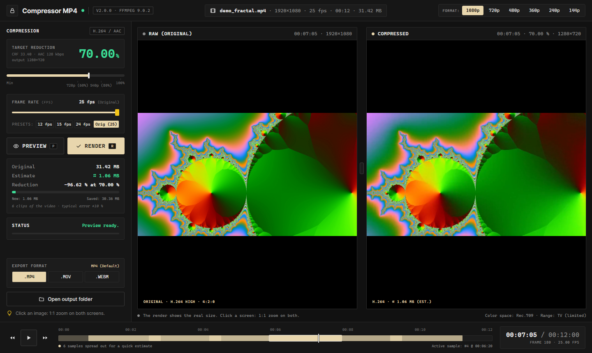

# Compressor MP4

**See exactly what you lose before you compress.** A local video compressor that shows the original and the compressed frame side by side, estimates the final file size in about a second, and only then renders the whole video.

It runs entirely on your computer: a small Python server on `127.0.0.1` plus ffmpeg, with the UI in your browser. Nothing is uploaded anywhere.



## Features

- **Side-by-side preview** of the same frame, original vs. compressed, using the exact ffmpeg settings of the final render.
- **Synced 1:1 zoom**: click either image to inspect pixels on both screens at once.
- **Size estimate** in ~1.5 s: 6 short clips spread across the video are encoded in parallel and extrapolated (typical error ±10 %).
- **One slider** (0–100 %) for quality + size, plus:
  - **Resolution cap** (1080p … 144p, never upscales)
  - **Frame rate** (1 fps up to the original, never raised)
  - **Export format**: MP4 or MOV (H.264 + AAC), WebM (VP9 + Opus)
- **Frame-accurate timeline**: `minute:second:frame` timecode, ⏪/⏩ one frame at a time, ▶ plays the original.
- **Safe by default**: never overwrites a file, never leaves `input/`, ignores requests from other websites.
- Keyboard: **P** preview · **R** render · **space** play/pause · **← →** one frame.

## Quick start (Windows)

1. Install [Python 3](https://www.python.org/downloads/) and tick **"Add Python to PATH"**.
2. Double-click **`OPEN_COMPRESSOR.bat`**. The browser opens by itself. Close the black window to stop.

On the first run, if ffmpeg is not on your `PATH`, the script installs it with `pip install --user imageio-ffmpeg` (~30 MB).

### Other systems / command line

```bash
pip install imageio-ffmpeg   # skip if ffmpeg is already installed
python app/server.py         # options: --port 8765 --no-browser
```

Works anywhere Python 3.9+ and ffmpeg run. The "Open output folder" button only works on Windows.

## How to use

1. **Drop a video** (MP4, MOV, M4V, MKV, WebM, AVI) anywhere in the window. It is copied to `input/`.
2. **Pick a frame** on the timeline. The left screen (**Raw**) shows the original.
3. **Set the compression** with the slider, the frame rate and the resolution cap.
4. **Preview** (or **P**): the right screen (**Compressed**) shows the same frame compressed, then the estimated size and savings appear.
5. Changed the frame or a setting? The compressed screen dims until you press Preview again.
6. **Render** (or **R**): writes the whole file to `output/`, e.g. `clip_c70.00.mp4` (or `clip_c70.00_12fps.webm`), and shows the real size.

## What the slider does

| % | Quality (H.264 CRF) | Resolution (shorter side) | AAC audio |
|---|---|---|---|
| 0 | 18 (near lossless) | original | 160 kbps |
| 0–59.99 | 18 → 31.2 | original | 160 / 128 kbps (from 50 %) |
| 60–79.99 | 31.2 → 35.6 | up to 720p | 128 kbps |
| 80–100 | 35.6 → 40 | up to 540p | 96 kbps |

- The limit applies to the shorter side, so portrait videos work too (1080×1920 → 720×1280).
- WebM uses VP9 CRF 24 → 54 and Opus at 128 / 96 / 64 kbps.
- Preview, estimate and render share the same ffmpeg arguments (x264 `preset faster`), so what you see is what you get.

## Performance

Measured on an 8-core / 16-thread desktop CPU with a 55 s 1080p clip at 70 %:

| Operation | Time | CPU |
|---|---|---|
| Idle | — | ~0 % |
| Timeline frame | 0.18 s | ~27 % |
| Preview | 0.46 s | ~47 % |
| Size estimate (first time per setting) | 1.35 s | ~100 % (on purpose, short burst) |
| Render | 5.9 s (~225 frames/s) | ~80 % |

Details and alternatives (x264 presets, NVENC on the GPU, VMAF scores) in [docs/review_and_benchmark.md](docs/review_and_benchmark.md).

## Project layout

```
OPEN_COMPRESSOR.bat         starts the app (Windows)
app/server.py               local HTTP server (127.0.0.1): routes only
app/operations.py           what the app does: info, frame, preview, estimate, render
app/compression.py          rules: slider, cap, fps, format → ffmpeg arguments
app/ffmpeg_engine.py        ffmpeg calls and `ffmpeg -i` parsing
app/files.py                folders and safe file names
app/cache.py                small LRU cache (frames, estimates, info)
app/web/                    UI: index.html, style.css, js/
tests/test_regression.py    regression tests (rules + API + UI)
tests/test_real_videos.py   end-to-end test with your own videos
tests/benchmark.py          CPU / RAM / time of each operation
input/  output/             your videos (created on first run, never committed)
```

## Tests

```bash
python tests/test_regression.py                                  # 55 tests, ~30 s, temporary folders
python tests/test_real_videos.py VIDEO.mp4 --pct 70 [--format webm] [--fps 24]
python tests/benchmark.py VIDEO.mp4 --pct 70 [--variants]        # needs: pip install psutil
```

The UI tests use Playwright (`pip install playwright`) with the Edge or Chrome already on your system; without it those 5 tests are skipped.

## License

[MIT](LICENSE)
